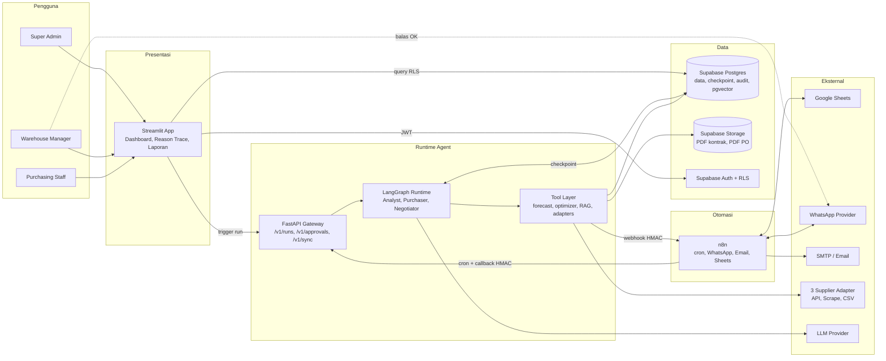
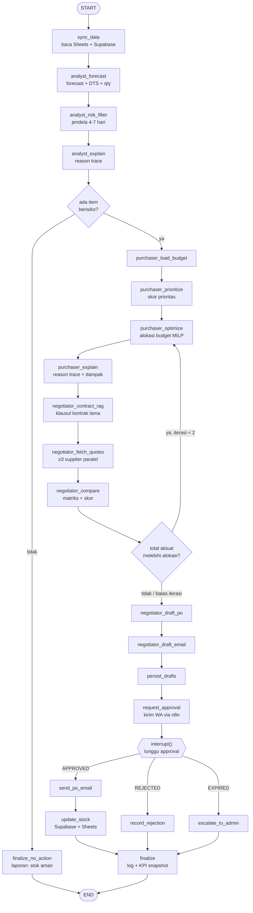
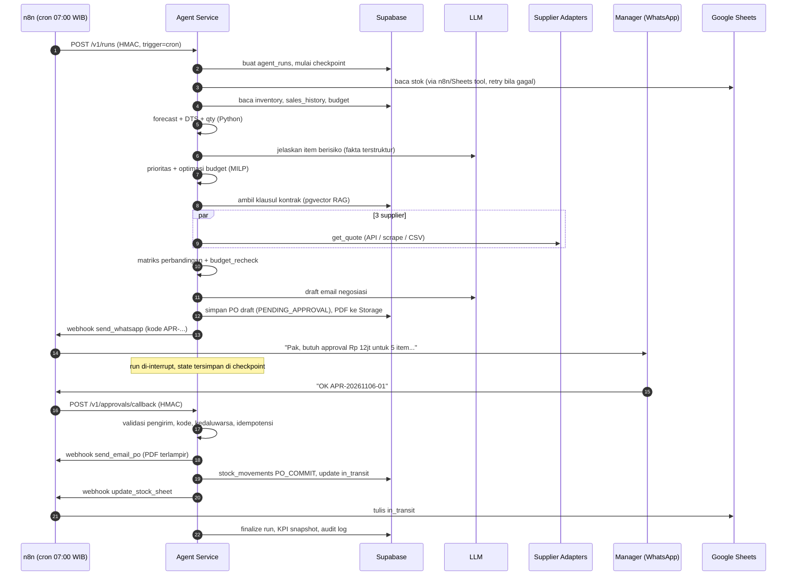
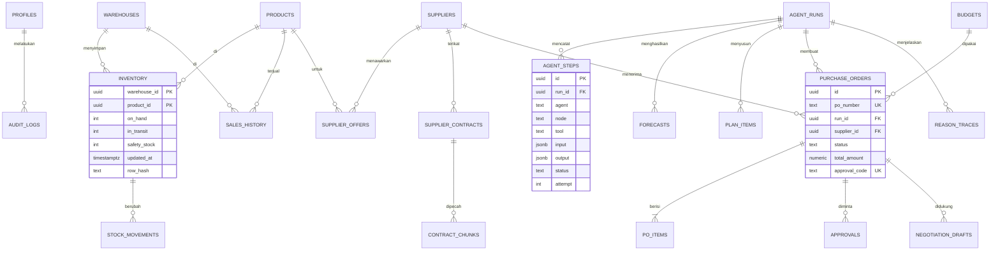
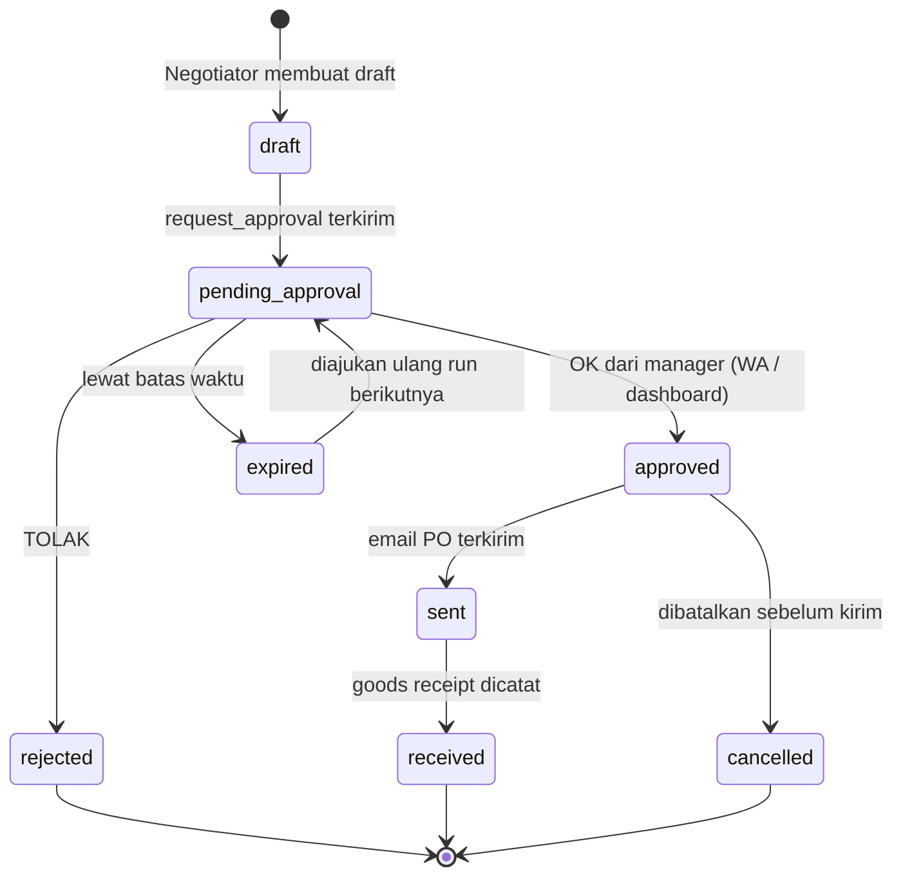

# StockQu: System Design Document

**Multi-Agent Inventory & Procurement System** | GTNIC Grand Final, kategori Enterprise & Industry
**Versi:** 1.0 (draft desain) | **Tanggal:** 6 November 2026 | **Basis:** Penjelasan Proyek Final v1.0 + SRS 35 item (F-01 s.d. F-35)

---

## Daftar Isi

1. [Tujuan, Ruang Lingkup, dan Non-Goals](#1-tujuan-ruang-lingkup-dan-non-goals)
2. [Telaah Proyek: Temuan dan Keputusan Desain](#2-telaah-proyek-temuan-dan-keputusan-desain)
3. [Pemilihan Arsitektur](#3-pemilihan-arsitektur)
4. [Arsitektur Tingkat Tinggi](#4-arsitektur-tingkat-tinggi)
5. [Desain Orkestrasi LangGraph](#5-desain-orkestrasi-langgraph)
6. [Spesifikasi Agent](#6-spesifikasi-agent)
7. [Katalog Tools](#7-katalog-tools)
8. [Model Data](#8-model-data)
9. [Kontrak API dan Webhook](#9-kontrak-api-dan-webhook)
10. [Integrasi n8n, WhatsApp, Email, dan Google Sheets](#10-integrasi-n8n-whatsapp-email-dan-google-sheets)
11. [Alur Approval dan State Machine PO](#11-alur-approval-dan-state-machine-po)
12. [Keandalan: Self-Correction dan Error Handling](#12-keandalan-self-correction-dan-error-handling)
13. [Keamanan, RBAC, dan Audit](#13-keamanan-rbac-dan-audit)
14. [Reason Trace dan Execution Trace](#14-reason-trace-dan-execution-trace)
15. [Frontend Streamlit](#15-frontend-streamlit)
16. [Laporan, Analitik, dan Export](#16-laporan-analitik-dan-export)
17. [Deployment dan Environment](#17-deployment-dan-environment)
18. [Non-Functional Requirements](#18-non-functional-requirements)
19. [Strategi Pengujian dan Evaluasi](#19-strategi-pengujian-dan-evaluasi)
20. [Traceability Matrix F-01 s.d. F-35](#20-traceability-matrix-f-01-sd-f-35)
21. [Risiko dan Mitigasi](#21-risiko-dan-mitigasi)
22. [Struktur Repo dan Roadmap](#22-struktur-repo-dan-roadmap)
23. [Asumsi dan Pertanyaan Terbuka](#23-asumsi-dan-pertanyaan-terbuka)

---

## 1. Tujuan, Ruang Lingkup, dan Non-Goals

### 1.1 Tujuan

StockQu adalah sistem multi-agent yang menjalankan siklus pengadaan secara otonom setiap hari:

> **cek stok → prediksi habis → prioritaskan pembelian dengan budget terbatas → bandingkan ≥3 supplier → buat draft PO → minta approval via WhatsApp → kirim PO via email → update stok → catat audit.**

Manusia (Warehouse Manager) tetap memegang keputusan finansial di titik approval (_human-in-the-loop_).

### 1.2 Prinsip Desain

| #   | Prinsip                                             | Implikasi                                                                                                                                                                             |
| --- | --------------------------------------------------- | ------------------------------------------------------------------------------------------------------------------------------------------------------------------------------------- |
| P1  | **Angka dihitung oleh kode, bukan oleh LLM**        | Forecast, safety stock, optimasi budget, dan scoring supplier adalah fungsi Python deterministik. LLM hanya menafsirkan, menjelaskan, mengekstrak klausul kontrak, dan menulis draft. |
| P2  | **Workflow dengan node agentik, bukan agent bebas** | Urutan Analyst → Purchaser → Negotiator tetap (graph deterministik). Otonomi LLM ada di dalam node (memilih tool, mengevaluasi hasil), bukan di rute utama.                           |
| P3  | **Aksi berisiko dijaga di kode, bukan di prompt**   | Tool tulis (kirim email, update stok) hanya bisa dipanggil jika state graph menyatakan `approval.status == APPROVED`.                                                                 |
| P4  | **Semua keputusan bisa diaudit**                    | Setiap langkah dan tool call tercatat di `agent_steps`; setiap alasan keputusan punya struktur fakta yang bisa ditelusuri.                                                            |
| P5  | **Idempoten dan tahan gagal**                       | Run bisa di-retry, webhook bisa terkirim dua kali, tanpa PO ganda atau stok ganda.                                                                                                    |
| P6  | **Durable**                                         | Run yang menunggu approval berjam-jam tidak hilang saat service restart (checkpoint di Postgres).                                                                                     |

### 1.3 In Scope

Seluruh F-01 s.d. F-35: multi-gudang, 3 agent, orkestrasi LangGraph, cron harian 07:00 WIB, integrasi n8n (WhatsApp, Email), sinkron Google Sheets, dashboard Streamlit, laporan analitik, export PDF/Excel, deploy live dengan repo publik.

### 1.4 Non-Goals

- Pembayaran, invoicing, rekonsiliasi faktur (3-way matching).
- MRP/BOM penuh untuk manufaktur. _Raw material diperlakukan sebagai SKU biasa._
- Transfer antar-gudang otomatis (dicatat sebagai pengembangan lanjut).
- Model forecasting deep learning. Dengan histori 6 bulan, metode statistik klasik lebih tepat dan lebih bisa dijelaskan.

---

## 2. Telaah Proyek: Temuan dan Keputusan Desain

Bagian ini merangkum hasil telaah dokumen proyek. Setiap temuan diterjemahkan menjadi keputusan desain yang mengikat di dokumen ini.

### 2.1 Kekuatan Konsep

- Problem jelas dan terukur (stockout vs dead stock), cocok dengan kriteria Dampak Bisnis.
- Loop otonom end-to-end dengan titik approval manusia, cocok dengan kriteria Potensi Otonomi (25%) dan Tool Use (15%).
- Constraint budget nyata membuat Purchaser punya _decision-making_ sungguhan, bukan sekadar ringkasan.
- Reason Trace dan Execution Trace adalah pembeda utama dari dashboard BI dan chatbot.

### 2.2 Celah dan Ambiguitas pada Dokumen Sumber

| ID   | Temuan                                                                                                                                                                     | Dampak jika dibiarkan                              | Keputusan Desain                                                                                                                                                                                                                                                                |
| ---- | -------------------------------------------------------------------------------------------------------------------------------------------------------------------------- | -------------------------------------------------- | ------------------------------------------------------------------------------------------------------------------------------------------------------------------------------------------------------------------------------------------------------------------------------- |
| T-01 | **Ketergantungan sirkular harga.** Purchaser mengalokasikan budget (butuh harga), tetapi harga aktual baru diketahui Negotiator (urutan Analyst → Purchaser → Negotiator). | Total PO bisa melebihi budget alokasi.             | Purchaser memakai **harga referensi** (kontrak terakhir / harga historis). Setelah Negotiator mendapat kuotasi aktual, ada node **`budget_recheck`** yang bisa mengembalikan alur ke Purchaser (maks. 2 iterasi). Lihat §5.                                                     |
| T-02 | **Semantik F-29 "update stok setelah approval".** Barang belum datang saat PO disetujui. Jika `on_hand` langsung naik, stok menjadi palsu.                                 | Kalkulasi forecast salah.                          | Stok dipecah menjadi `on_hand` dan `in_transit`. Saat approval, `in_transit` bertambah; `on_hand` bertambah saat **goods receipt** (tombol simulasi di demo). Flag `STOCK_UPDATE_MODE` tersedia jika juri menghendaki `on_hand` langsung naik.                                  |
| T-03 | **Duplikasi pembelian antar-hari.** Cron jalan tiap hari. Barang yang sudah di-PO tetapi belum tiba bisa terdeteksi kritis lagi.                                           | PO ganda, budget terbuang.                         | Forecast selalu memperhitungkan `in_transit` dan PO `PENDING_APPROVAL`. Budget yang sedang pending dihitung sebagai _committed_.                                                                                                                                                |
| T-04 | **Approval WhatsApp "balas OK" ambigu** jika ada lebih dari satu permintaan pending.                                                                                       | OK menyetujui PO yang salah.                       | Setiap permintaan punya **kode approval** (`APR-YYYYMMDD-NN`). Format balasan: `OK APR-...`. `OK` polos hanya diterima jika tepat satu permintaan pending. Nomor pengirim divalidasi whitelist.                                                                                 |
| T-05 | **Angka tidak konsisten**: contoh "5 item, 3 draft PO, Rp 12jt dari Rp 50jt".                                                                                              | Juri bertanya cara hitungnya.                      | Dibaca sebagai: 5 SKU kritis dikelompokkan per supplier menjadi 3 PO, total Rp 12jt, sisa budget Rp 38jt untuk siklus berikutnya. Data demo di-seed agar konsisten.                                                                                                             |
| T-06 | **Klaim "tren musiman" dari histori 6 bulan.** Seasonality tahunan tidak bisa dideteksi dari 6 bulan.                                                                      | Klaim bisa dipatahkan juri.                        | Yang dideteksi: **pola mingguan** (day-of-week), **tren** (7 vs 7 hari), dan **event kalender** terdaftar (gajian, Ramadan/Lebaran, promo) lewat tabel `calendar_events`. Reasoning menyebut persis yang terdeteksi.                                                            |
| T-07 | **Target "kurangi stockout 80%", "hemat 15 jam/minggu"** tanpa baseline terukur.                                                                                           | Klaim tak bisa diverifikasi.                       | Dibuktikan lewat **simulasi replay** pada data historis: kebijakan lama (`stok < 10 → beli`) vs StockQu. Dilaporkan sebagai hasil simulasi dan diberi label jelas (lihat §19).                                                                                                  |
| T-08 | **"Cari harga via API atau web scraping"** dari 3 supplier. Supplier nyata jarang punya API publik.                                                                        | Fitur jadi dummy atau melanggar ToS.               | Tiga **supplier adapter** di bawah kendali tim: (A) REST API, (B) halaman katalog HTML yang di-scrape, (C) CSV/Sheet katalog. Di-host sebagai _mock supplier service_ dan dinyatakan transparan sebagai lingkungan simulasi. Antarmuka adapter siap dipasang ke supplier nyata. |
| T-09 | **Streamlit tidak cocok untuk proses panjang, cron, dan webhook.**                                                                                                         | Cron mati saat app tidur, run terputus saat rerun. | UI (Streamlit) **dipisah** dari runtime agent (FastAPI + LangGraph). Cron dipegang n8n. Lihat §3.                                                                                                                                                                               |
| T-10 | **Approval asinkron** (manager bisa membalas 3 menit atau 3 jam kemudian).                                                                                                 | Proses tertahan, state hilang.                     | LangGraph `interrupt()` + checkpointer Postgres: run _pause_, lalu _resume_ saat webhook approval tiba.                                                                                                                                                                         |
| T-11 | **Sinkron dua arah Sheets ↔ Supabase** tanpa aturan konflik.                                                                                                               | Data saling menimpa.                               | **Field ownership**: Sheets pemilik `on_hand` (hitungan fisik oleh staf gudang); Supabase pemilik `in_transit`, `safety_stock`, dan hasil agent. Setiap upsert membawa `row_hash` dan `updated_at`.                                                                             |
| T-12 | **Kontrak dan halaman supplier adalah input tak tepercaya** (risiko prompt injection).                                                                                     | Teks di PDF/HTML bisa memerintah agent.            | Konten eksternal diperlakukan sebagai **data**, diekstrak ke skema terstruktur (Pydantic), dan tidak pernah dieksekusi sebagai instruksi. Gate tool di kode (P3).                                                                                                               |
| T-13 | **Narasi LLM bisa mengarang angka** pada reasoning trace.                                                                                                                  | Trace tidak bisa dipercaya.                        | Trace dibangun dari **fakta terstruktur** dari tool. LLM hanya merangkai kalimat. Ada **number-grounding check**: setiap angka di narasi harus ada di fakta, jika tidak maka fallback ke template.                                                                              |
| T-14 | **Target pengguna meliputi manufaktur**, padahal SRS tidak memuat BOM/MRP.                                                                                                 | Ekspektasi berlebih.                               | Dinyatakan non-goal. Raw material diperlakukan sebagai SKU.                                                                                                                                                                                                                     |
| T-15 | **Supabase free tier bisa pause** saat tidak aktif, dan Streamlit Community Cloud bisa tidur.                                                                              | Demo live gagal.                                   | _Keep-alive_ via n8n, health check, dan prosedur _warm-up_ sebelum demo.                                                                                                                                                                                                        |

---

## 3. Pemilihan Arsitektur

### 3.1 Opsi yang Dipertimbangkan

| Opsi                                 | Deskripsi                                                                                                            | Kelebihan                                                                                           | Kekurangan                                                                                       | Verdict |
| ------------------------------------ | -------------------------------------------------------------------------------------------------------------------- | --------------------------------------------------------------------------------------------------- | ------------------------------------------------------------------------------------------------ | ------- |
| **A. Monolit Streamlit**             | LangGraph berjalan di dalam proses Streamlit                                                                         | Paling sederhana, satu deploy                                                                       | Tidak ada cron andal, run terputus saat rerun/sleep, tidak bisa menerima webhook, sulit di-scale | ❌      |
| **B. n8n sebagai otak**              | Seluruh logika agent dibuat sebagai workflow n8n                                                                     | Cepat dibangun                                                                                      | Bukan LangGraph (melanggar F-23), state dan retry terbatas, sulit di-test dan di-versioning      | ❌      |
| **C. Hybrid event-driven (dipilih)** | Streamlit (UI) + FastAPI/LangGraph (runtime agent) + Supabase (data, auth, vector, storage) + n8n (cron & integrasi) | Pemisahan tanggung jawab jelas; durable; testable; sesuai semua F-xx; tetap deployable gratis/murah | Empat komponen untuk dioperasikan                                                                | ✅      |
| **D. Microservice per agent**        | Tiap agent service sendiri + message broker                                                                          | Skalabel                                                                                            | Overkill untuk skala 3 gudang dan 1 tim; operasional berat                                       | ❌      |

### 3.2 Pola Orkestrasi yang Dipilih

**Deterministic pipeline graph dengan node agentik, siklus terbatas, dan human-in-the-loop berbasis checkpoint.**

- _Bukan_ supervisor yang memilih agent secara dinamis oleh LLM, karena alur bisnis tetap dan harus bisa diaudit.
- Node agentik (Analyst, Negotiator) memakai pola _tool-calling_ dengan validasi output dan retry (self-correction).
- Purchaser berpusat pada _optimizer deterministik_ + LLM untuk penjelasan.

### 3.3 Pembagian Tanggung Jawab Komponen

| Komponen                                | Tanggung jawab                                                               | Bukan tanggung jawabnya                  |
| --------------------------------------- | ---------------------------------------------------------------------------- | ---------------------------------------- |
| **Streamlit**                           | Presentasi, input pengguna, trigger manual, tampilan trace                   | Menjalankan agent, cron, webhook         |
| **Agent Service (FastAPI + LangGraph)** | Runtime graph, tools Python, forecasting, optimizer, RAG, endpoint callback  | Scheduling, pengiriman WA/Email langsung |
| **n8n**                                 | Cron 07:00 WIB, jembatan WhatsApp/Email/Sheets, notifikasi error, keep-alive | Logika keputusan                         |
| **Supabase**                            | Postgres (data + checkpoint), Auth, RLS, pgvector, Storage, Realtime         | Komputasi agent                          |
| **Google Sheets**                       | Input stok operasional oleh staf gudang, cermin `in_transit`                 | Sumber kebenaran untuk hasil agent       |

---

## 4. Arsitektur Tingkat Tinggi

### 4.1 Diagram Container



### 4.2 Alur Data Utama

1. **Masuk:** Google Sheets → n8n → `POST /v1/sync/sheets` → Supabase (`inventory`).
2. **Proses:** Cron n8n → `POST /v1/runs` → LangGraph membaca Supabase → hasil tiap node ditulis ke Supabase.
3. **Keluar:** Tool `send_whatsapp` / `send_email_po` / `update_stock_sheet` → webhook n8n → provider.
4. **Balik:** Balasan WhatsApp → n8n → `POST /v1/approvals/callback` → resume graph.
5. **Tampil:** Streamlit membaca Supabase (RLS) dan memantau run lewat polling/Realtime.

---

## 5. Desain Orkestrasi LangGraph

### 5.1 State Schema (ringkas)

```python
class RunState(TypedDict):
    run_id: str
    trigger: Literal["cron", "manual", "retry"]
    as_of: date
    # --- Data ---
    inventory: list[InventoryRow]          # snapshot per (gudang, SKU)
    data_quality: DataQualityReport        # flag: stale sheet, fallback dipakai, dll.
    # --- Analyst ---
    forecasts: list[ForecastResult]        # μ_d, σ_d, DTS P50/P90, rekomendasi qty
    at_risk: list[AtRiskItem]              # DTS dalam jendela deteksi (default 4-7 hari)
    analyst_traces: list[ReasonTrace]
    # --- Purchaser ---
    budget: BudgetState                    # total, spent, committed, available
    plan: PurchasePlan                     # selected[], deferred[], metode, status feasibility
    purchaser_traces: list[ReasonTrace]
    # --- Negotiator ---
    contract_terms: dict[SupplierId, ContractTerms]
    quotes: list[SupplierQuote]            # ≥3 supplier per SKU
    comparison: list[ComparisonMatrix]
    po_drafts: list[PODraft]
    negotiation_emails: list[EmailDraft]
    # --- Kontrol ---
    iteration: dict[str, int]              # penghitung loop (budget_recheck, dll.)
    approval: ApprovalState | None         # PENDING / APPROVED / REJECTED / EXPIRED
    errors: list[ErrorRecord]
    status: RunStatus
```

State kecil di checkpoint, sedangkan data besar (forecast per SKU, kuotasi) ditulis ke tabel dan state hanya menyimpan ID/ringkasan.

### 5.2 Graph



### 5.3 Keputusan Kunci

| Topik                     | Keputusan                                                                                                     | Alasan                                                                                                                                     |
| ------------------------- | ------------------------------------------------------------------------------------------------------------- | ------------------------------------------------------------------------------------------------------------------------------------------ |
| **Checkpointer**          | `PostgresSaver` (Supabase Postgres), `thread_id = run_id`                                                     | Run tahan restart dan bisa menunggu approval lama.                                                                                         |
| **Human-in-the-loop**     | `interrupt()` di node setelah `request_approval`; resume memakai `Command(resume=...)` dari endpoint callback | Native LangGraph, state terjaga. _Fallback:_ pecah menjadi dua graph (_planning graph_ dan _fulfillment graph_) jika interrupt bermasalah. |
| **Loop `budget_recheck`** | Maks. 2 iterasi, lalu lanjut dengan flag "melebihi alokasi, butuh keputusan manager"                          | Mencegah loop tak berujung (T-01).                                                                                                         |
| **Single active run**     | Unique index `(run_date, trigger)` untuk cron + advisory lock                                                 | Mencegah dua run paralel pada hari yang sama.                                                                                              |
| **Retry level node**      | `RetryPolicy` LangGraph + dekorator `tenacity` di tool                                                        | Lihat §12.                                                                                                                                 |
| **Streaming**             | `astream_events` → `TraceCallbackHandler` → tabel `agent_steps`                                               | Dashboard bisa menampilkan progres hampir real-time.                                                                                       |
| **Paralelisme**           | `fetch_quotes` memakai fan-out per supplier (`asyncio.gather`); forecast di-vectorize per batch SKU           | Target siklus ≈ 15 menit.                                                                                                                  |

### 5.4 Sequence End-to-End (termasuk Approval)



---

## 6. Spesifikasi Agent

### 6.1 Agent 1: The Analyst (F-06 s.d. F-10)

**Input:** `inventory` (per gudang × SKU), `sales_history` 180 hari, `suppliers/lead_time`, `calendar_events`.
**Output:** `forecasts[]`, `at_risk[]`, `analyst_traces[]`.

#### a. Persiapan Data

- Agregasi penjualan harian per (gudang, SKU), hari tanpa penjualan diisi 0.
- **Penanganan demand tersensor:** hari ketika stok = 0 ditandai (penjualan 0 bukan berarti tidak ada permintaan) dan di-impute dengan rata-rata hari-hari sebanding.
- Winsorize outlier pada persentil 99.

#### b. Pemilihan Model per SKU

| Pola permintaan     | Kriteria (ADI / CV²)      | Model                                      |
| ------------------- | ------------------------- | ------------------------------------------ |
| Halus/stabil        | ADI < 1,32 dan CV² < 0,49 | ETS / Holt-Winters (musiman mingguan, m=7) |
| Erratic             | ADI < 1,32 dan CV² ≥ 0,49 | ETS dengan damped trend                    |
| Intermittent/lumpy  | ADI ≥ 1,32                | Croston-SBA / TSB                          |
| Baseline pembanding | semua                     | Rata-rata bergerak 14 hari                 |

Pemilihan model memakai **rolling-origin backtest** (4 fold × horizon 7 hari). Pemenang ditentukan oleh WAPE terendah dan harus mengalahkan baseline. Jika tidak, baseline dipakai. Library kandidat: `statsforecast` atau `statsmodels`.

#### c. Rumus Inti

```text
μ_d, σ_d          = forecast harian rata-rata & simpangan residual (horizon H)
DTS_P50           = hari pertama ketika Σ μ_d ≥ (on_hand)           # days-to-stockout
DTS_P90           = hari pertama ketika Σ (μ_d + 1.28·σ_d) ≥ on_hand # skenario pesimistis
Saat in_transit tiba pada hari ETA, tambahkan qty-nya ke proyeksi stok.

Safety stock      SS = z · σ_d · √(L)                 # z=1.65 (service level 95%)
Reorder point     ROP = μ_d · L + SS
Qty restock       Q  = max(0, μ_d·(L+R) + z·σ_d·√(L+R) − (on_hand + in_transit))
                  lalu dibulatkan ke atas ke kelipatan MOQ/pack
Order-by date     = as_of + (DTS_P50 − L)             # jika ≤ 0 → sudah terlambat
```

`L` = lead time supplier, `R` = review period (default 1 hari untuk cron harian; bisa 7).

#### d. Klasifikasi Risiko

| Level      | Kondisi                                                                              |
| ---------- | ------------------------------------------------------------------------------------ |
| `CRITICAL` | DTS_P50 ≤ 3 hari **atau** DTS_P50 < lead time (diprediksi habis sebelum barang tiba) |
| `HIGH`     | 4 ≤ DTS_P50 ≤ 7 (jendela deteksi SRS F-08)                                           |
| `MEDIUM`   | 8 ≤ DTS_P50 ≤ 14                                                                     |
| `OK`       | > 14                                                                                 |

Jendela 4-7 hari dibuat konfigurabel di tabel `settings`.

#### e. Fakta untuk Reasoning (F-10)

Tool `compute_trend_facts` menghasilkan fakta terukur: perubahan penjualan 7 hari vs 7 hari sebelumnya, indeks hari-dalam-minggu, event kalender aktif, WAPE backtest model terpilih. LLM menyusun narasi **hanya dari fakta ini** (lihat §14).

### 6.2 Agent 2: The Purchaser (F-11 s.d. F-15)

**Input:** `at_risk[]`, budget bulanan (default Rp 50.000.000), harga referensi, margin, turnover.
**Output:** `plan` (selected/deferred), `purchaser_traces[]`, estimasi dampak bisnis.

#### a. Budget yang Tersedia

```text
available = budget_bulan_ini − spent (PO APPROVED/SENT/RECEIVED) − committed (PO PENDING_APPROVAL)
```

#### b. Skor Prioritas (bobot disimpan di `settings`, bisa dituning)

```text
slack_i    = DTS_P50_i − L_i                         # hari sisa sebelum HARUS memesan
urgency_i  = clip(1 − slack_i / H, 0, 1)             # H = 14; slack ≤ 0 → urgency 1
margin_i   = margin_pct_i / max_margin
turnover_i = turnover_i / max_turnover
disc_i     = diskon_valid_hari_ini_i / max_diskon

score_i = 0.45·urgency + 0.25·margin + 0.20·turnover + 0.10·disc
```

#### c. Optimasi Alokasi Budget (F-14)

Masalah _multi-choice knapsack_ dengan MOQ, diselesaikan MILP (OR-Tools CP-SAT atau PuLP).

```text
Variabel   : q_i ∈ {0} ∪ [q_min_i, q_full_i], kelipatan pack
Nilai      : V_i = score_i × expected_lost_margin_i       (Rp margin yang hilang jika stockout)
Objektif   : maksimalkan Σ V_i · min(q_i, q_full_i) / q_full_i
Kendala    : Σ harga_i · q_i ≤ available
Tier-1     : item CRITICAL wajib q_i ≥ q_min_i (cukup sampai siklus suplai berikutnya)
```

- Jika kendala Tier-1 **tidak feasible**, statusnya `BUDGET_INSUFFICIENT`. Plan tetap dibuat, dan pesan WhatsApp menyertakan permintaan keputusan: "butuh tambahan Rp X atau tunda item Y".
- _Fallback_ bila solver gagal atau timeout: greedy berdasarkan `V_i / biaya_i`, dengan flag `method=greedy_fallback` di trace.

#### d. Estimasi Dampak Bisnis (F-15)

Dihitung dari data, bukan dari LLM:

- _Stockout days avoided_ = Σ (hari proyeksi habis tanpa PO − hari proyeksi habis dengan PO).
- _Margin terselamatkan_ = unit terselamatkan × margin per unit.
- _Waktu cek manual dihemat_ = konfigurasi `manual_check_minutes_per_sku × jumlah SKU × frekuensi`, dengan asumsi ditampilkan eksplisit di UI.

### 6.3 Agent 3: The Negotiator (F-16 s.d. F-20)

**Input:** `plan.selected`, kontrak supplier (pgvector), adapter supplier.
**Output:** `quotes[]`, `comparison[]`, `po_drafts[]`, `negotiation_emails[]`.

#### a. RAG Kontrak (F-16)

- **Ingest:** PDF di Storage → ekstraksi teks → chunking (± 500 token, overlap 80, mempertahankan batas pasal) → embedding → `contract_chunks` (pgvector).
- **Retrieve:** query per (supplier, topik: harga, diskon volume, termin pembayaran, lead time, penalti) → top-k + metadata filter `supplier_id` → **ekstraksi terstruktur** ke `ContractTerms` (Pydantic) dengan sitasi `chunk_id`.
- Hasil dipakai sebagai: harga/diskon yang sudah disepakati, batas MOQ, termin bayar, dan "leverage" untuk draft negosiasi.

#### b. Kuotasi ≥3 Supplier (F-17)

```python
class SupplierAdapter(Protocol):
    supplier_id: str
    async def get_quote(self, sku: str, qty: int) -> SupplierQuote: ...
```

| Adapter                       | Mekanisme                                              | Catatan                                      |
| ----------------------------- | ------------------------------------------------------ | -------------------------------------------- |
| `ApiAdapter` (Supplier A)     | REST JSON, auth API key                                | timeout 10 detik, retry 3×                   |
| `ScrapeAdapter` (Supplier B)  | `httpx` + parser HTML (Playwright hanya jika perlu JS) | patuhi `robots.txt`, rate limit, cache 1 jam |
| `CatalogAdapter` (Supplier C) | CSV/Sheet katalog                                      | cadangan tetap, versi katalog tercatat       |

- Setiap `SupplierQuote` menyimpan `fetched_at`, `source`, dan `is_stale` (jika memakai cache).
- Jika satu supplier gagal: pakai kuotasi cache terakhir dan tandai **stale**. Jika <3 kuotasi valid, plan lanjut dengan flag `INSUFFICIENT_QUOTES` yang tampil di UI dan WhatsApp.

#### c. Matriks Perbandingan (F-18)

```text
Skor supplier (0-100) = 40% harga_efektif + 20% lead_time + 15% diskon_valid + 25% performa
harga_efektif = harga × (1 − diskon) , dinormalisasi per SKU
performa      = 0.6·on_time_rate + 0.4·quality_score (dari data historis supplier)
```

Bobot konfigurabel. Kendala keras: lead time ≤ `days_to_stockout` bila memungkinkan, dan MOQ terpenuhi.

#### d. Draft PO dan Email (F-19)

- Item dikelompokkan per supplier terpilih → satu PO per supplier (contoh demo: 5 SKU → 3 PO).
- `po_number` dibuat deterministik (`PO-YYYYMMDD-SUP-NN`) dari `run_id` agar idempoten.
- PDF PO dibuat dengan template (ReportLab/WeasyPrint), bukan oleh LLM.
- Email negosiasi: LLM menulis dari data terstruktur (harga pembanding, klausul kontrak, volume). Output divalidasi: tidak boleh memuat angka di luar fakta, dan tidak ada komitmen di luar batas yang ditetapkan (mis. diskon target maks.).

#### e. Kirim ke Approval (F-20)

Persist PO berstatus `PENDING_APPROVAL`, lalu panggil `request_approval` (§11).

---

## 7. Katalog Tools

Seluruh tool ber-_type hint_ dan skema Pydantic, serta memiliki `idempotency_key` bila bersifat tulis.

| Tool                         | Jenis                      | Dipakai oleh     | Implementasi                   | F          |
| ---------------------------- | -------------------------- | ---------------- | ------------------------------ | ---------- |
| `read_inventory_sheet`       | baca                       | sync_data        | Google Sheets via n8n / API    | F-01, F-30 |
| `read_inventory_db`          | baca                       | sync_data        | Supabase                       | F-01       |
| `read_sales_history`         | baca                       | Analyst          | Supabase                       | F-06       |
| `forecast_demand`            | hitung                     | Analyst          | statsforecast/statsmodels      | F-07       |
| `compute_trend_facts`        | hitung                     | Analyst          | pandas                         | F-10       |
| `compute_restock_qty`        | hitung                     | Analyst          | Python (rumus §6.1)            | F-09       |
| `get_budget_state`           | baca                       | Purchaser        | Supabase                       | F-11       |
| `score_priority`             | hitung                     | Purchaser        | Python                         | F-12       |
| `optimize_budget_allocation` | hitung                     | Purchaser        | OR-Tools/PuLP                  | F-14       |
| `search_contract_clauses`    | baca                       | Negotiator       | pgvector + LLM ekstraksi       | F-16       |
| `fetch_supplier_quote`       | baca                       | Negotiator       | 3 adapter                      | F-17       |
| `compare_suppliers`          | hitung                     | Negotiator       | Python                         | F-18       |
| `generate_po_pdf`            | tulis (artefak)            | Negotiator       | ReportLab/WeasyPrint → Storage | F-19, F-35 |
| `send_whatsapp`              | **tulis eksternal**        | request_approval | webhook n8n                    | F-26       |
| `send_email_po`              | **tulis eksternal, gated** | send_po_email    | webhook n8n                    | F-28       |
| `update_stock_db`            | **tulis, gated**           | update_stock     | Supabase (ledger)              | F-29       |
| `update_stock_sheet`         | **tulis eksternal, gated** | update_stock     | webhook n8n → Sheets           | F-29       |
| `write_audit`                | tulis                      | semua            | Supabase (append-only)         | F-25       |

**Gating (P3):** tool bertanda _gated_ memeriksa `state.approval.status == APPROVED` dan `po.status` sebelum eksekusi. Pemeriksaan ada **di dalam fungsi tool**, bukan di prompt.

---

## 8. Model Data

### 8.1 ERD



### 8.2 Tabel Inti (DDL ringkas)

```sql
-- Enum
create type user_role   as enum ('super_admin','warehouse_manager','purchasing_staff');
create type run_status  as enum ('running','waiting_approval','completed','failed','no_action','cancelled');
create type po_status   as enum ('draft','pending_approval','approved','rejected','expired','sent','received','cancelled');
create type risk_level  as enum ('critical','high','medium','ok');

-- Profil & peran (terhubung ke auth.users)
create table profiles (
  id uuid primary key references auth.users(id),
  full_name text not null,
  role user_role not null,
  wa_number text,                       -- E.164, dipakai untuk whitelist approval
  is_active boolean not null default true
);

create table warehouses (
  id uuid primary key default gen_random_uuid(),
  code text unique not null, name text not null, city text not null
);

create table products (
  id uuid primary key default gen_random_uuid(),
  sku text unique not null, name text not null, category text,
  unit text not null default 'pcs',
  unit_cost numeric(14,2) not null, sell_price numeric(14,2) not null,
  moq int not null default 1, pack_size int not null default 1,
  is_active boolean not null default true
);

create table inventory (
  warehouse_id uuid references warehouses(id),
  product_id   uuid references products(id),
  on_hand int not null check (on_hand >= 0),
  in_transit int not null default 0 check (in_transit >= 0),
  safety_stock int not null default 0,
  source text not null default 'sheet',          -- sheet | agent | manual
  row_hash text, updated_at timestamptz not null default now(),
  primary key (warehouse_id, product_id)
);

-- Ledger: jejak setiap perubahan stok (F-29 + audit)
create table stock_movements (
  id bigserial primary key,
  warehouse_id uuid not null, product_id uuid not null,
  movement_type text not null,                   -- PO_COMMIT | RECEIPT | SALE | ADJUST | SYNC
  delta_on_hand int not null default 0,
  delta_in_transit int not null default 0,
  ref_type text, ref_id uuid, idempotency_key text unique,
  created_at timestamptz not null default now()
);

create table sales_history (
  warehouse_id uuid, product_id uuid, sale_date date, qty int not null, revenue numeric(14,2),
  primary key (warehouse_id, product_id, sale_date)
);

create table suppliers (
  id uuid primary key default gen_random_uuid(),
  name text not null, email text, source_type text not null,   -- api | scrape | catalog
  on_time_rate numeric(4,3), quality_score numeric(4,3), is_active boolean default true
);

create table supplier_offers (                   -- snapshot kuotasi
  id uuid primary key default gen_random_uuid(),
  run_id uuid, supplier_id uuid, product_id uuid,
  unit_price numeric(14,2), lead_time_days int, moq int,
  discount_pct numeric(5,2), discount_valid_until date,
  fetched_at timestamptz, source text, is_stale boolean default false
);

create table supplier_contracts (
  id uuid primary key default gen_random_uuid(),
  supplier_id uuid, title text, file_path text,
  valid_from date, valid_to date, status text
);
create table contract_chunks (
  id bigserial primary key, contract_id uuid, chunk_idx int, content text,
  embedding vector(1024)                          -- sesuaikan dimensi dengan model embedding
);

create table budgets (
  period char(7) primary key,                     -- 'YYYY-MM'
  total_amount numeric(16,2) not null default 50000000
);

-- Eksekusi agent
create table agent_runs (
  id uuid primary key default gen_random_uuid(),
  run_date date not null, trigger text not null, status run_status not null,
  started_at timestamptz default now(), finished_at timestamptz,
  summary jsonb, error text,
  unique (run_date, trigger) deferrable                     -- hanya satu cron per hari
);
create table agent_steps (
  id bigserial primary key, run_id uuid references agent_runs(id),
  agent text, node text, tool text, status text, attempt int default 1,
  input jsonb, output jsonb, error text, tokens_in int, tokens_out int,
  started_at timestamptz, duration_ms int
);

create table forecasts (
  run_id uuid, warehouse_id uuid, product_id uuid,
  method text, mu_daily numeric, sigma_daily numeric,
  dts_p50 numeric, dts_p90 numeric, risk risk_level,
  recommended_qty int, order_by date, wape numeric
);
create table plan_items (
  run_id uuid, warehouse_id uuid, product_id uuid, supplier_id uuid,
  qty int, unit_price numeric, line_total numeric, priority_score numeric,
  rank int, decision text                                   -- selected | deferred
);

create table purchase_orders (
  id uuid primary key default gen_random_uuid(),
  po_number text unique not null, run_id uuid, supplier_id uuid,
  status po_status not null default 'draft',
  total_amount numeric(16,2), approval_code text unique,
  pdf_path text, email_message_id text,
  approved_by uuid, approved_at timestamptz, expires_at timestamptz
);
create table po_items (
  po_id uuid references purchase_orders(id), product_id uuid, warehouse_id uuid,
  qty int, unit_price numeric(14,2), discount_pct numeric(5,2), line_total numeric(16,2)
);
create table approvals (
  id uuid primary key default gen_random_uuid(),
  approval_code text unique, channel text, requested_to uuid,
  response text, raw_message text, responded_by text,
  requested_at timestamptz, responded_at timestamptz, expires_at timestamptz,
  inbound_message_id text unique                             -- dedup webhook (idempotensi)
);

create table reason_traces (
  id uuid primary key default gen_random_uuid(),
  run_id uuid, agent text, subject_type text, subject_id uuid,
  conclusion text, factors jsonb, alternatives jsonb, narrative text,
  grounding_ok boolean
);

-- Audit: append-only
create table audit_logs (
  id bigserial primary key, ts timestamptz default now(),
  actor_type text, actor_id text, action text, entity text, entity_id text,
  before jsonb, after jsonb, ip inet
);
-- (revoke update, delete pada audit_logs dan stock_movements untuk semua role aplikasi)

create table settings (key text primary key, value jsonb not null);      -- bobot, jendela deteksi, dll.
create table calendar_events (event_date date, name text, demand_multiplier numeric);
create table kpi_snapshots (snapshot_date date primary key, metrics jsonb);
```

### 8.3 Aturan Data

- Semua tabel transaksi punya `created_at`, dan tabel yang bisa diedit punya `updated_at`.
- **Soft delete** untuk `products`, `suppliers` (`is_active`), agar histori PO tidak rusak.
- Nilai uang disimpan `numeric` (IDR, tanpa floating point).
- Indeks utama: `sales_history(product_id, sale_date)`, `agent_steps(run_id, started_at)`, `purchase_orders(status)`, `contract_chunks` (HNSW pada `embedding`).

---

## 9. Kontrak API dan Webhook

### 9.1 Endpoint Agent Service

| Method | Path                          | Auth                         | Fungsi                                                | F          |
| ------ | ----------------------------- | ---------------------------- | ----------------------------------------------------- | ---------- |
| POST   | `/v1/runs`                    | HMAC (n8n) atau JWT (manual) | Mulai run; `202 {run_id}`; menolak jika ada run aktif | F-21, F-22 |
| GET    | `/v1/runs/{id}`               | JWT                          | Status & ringkasan                                    | F-31       |
| POST   | `/v1/runs/{id}/retry`         | JWT (manager/admin)          | Ulang run gagal dari checkpoint                       | F-24       |
| POST   | `/v1/approvals/callback`      | HMAC (n8n)                   | Balasan WhatsApp → resume graph                       | F-27       |
| POST   | `/v1/approvals/{code}/decide` | JWT (manager)                | Approval via dashboard (cadangan)                     | F-27       |
| POST   | `/v1/sync/sheets`             | HMAC (n8n)                   | Upsert stok dari Sheets                               | F-01       |
| POST   | `/v1/goods-receipts`          | JWT                          | Simulasi/pencatatan barang tiba → `on_hand`           | F-29       |
| POST   | `/v1/contracts/{id}/ingest`   | JWT (admin)                  | Chunk + embed kontrak                                 | F-04, F-16 |
| POST   | `/v1/exports/{kind}`          | JWT                          | PDF/Excel PO & perbandingan                           | F-35       |
| GET    | `/healthz`, `/readyz`         | publik                       | Health & kesiapan (cek DB)                            | -          |
| GET    | `/mock/supplier-a/quote`      | API key                      | Mock supplier (API)                                   | F-17       |
| GET    | `/mock/supplier-b/catalog`    | publik                       | Mock supplier (HTML untuk di-scrape)                  | F-17       |

### 9.2 Keamanan Antar-Layanan (n8n ↔ Agent Service)

- Header `X-Timestamp`, `X-Nonce`, `X-Signature = HMAC-SHA256(secret, timestamp.nonce.body)`.
- Tolak jika selisih waktu > 5 menit atau `nonce` pernah dipakai (cache/tabel kecil).
- Secret berbeda per arah (n8n→agent dan agent→n8n) dan di-rotasi lewat env.

### 9.3 Contoh Payload

`POST /v1/approvals/callback`

```json
{
  "channel": "whatsapp",
  "inbound_message_id": "wamid.HBgM...",
  "from": "+62812XXXXXXX",
  "text": "OK APR-20261106-01",
  "received_at": "2026-11-06T07:21:44+07:00"
}
```

Respons: `200 {"status":"approved","po_numbers":[...]}`, atau `409` jika sudah diproses (idempoten), `403` jika pengirim tidak ada di whitelist, `410` jika kedaluwarsa.

---

## 10. Integrasi n8n, WhatsApp, Email, dan Google Sheets

### 10.1 Daftar Workflow n8n

| ID  | Nama                    | Trigger                                       | Aksi                                                                                         |
| --- | ----------------------- | --------------------------------------------- | -------------------------------------------------------------------------------------------- |
| W1  | `cron-daily-0700`       | Schedule `0 7 * * *`, timezone `Asia/Jakarta` | `POST /v1/runs {trigger:"cron"}`. Jika gagal, kirim alert ke admin (F-22).                   |
| W2  | `sheets-inbound-sync`   | Polling 5 menit / on-change                   | Baca baris berubah → `POST /v1/sync/sheets` (batch, dengan `row_hash`)                       |
| W3  | `wa-send-approval`      | Webhook dari agent                            | Format pesan → kirim WhatsApp → balas `message_id` (F-26)                                    |
| W4  | `wa-inbound-reply`      | Webhook provider WA                           | Parse `OK/TOLAK + kode` → `POST /v1/approvals/callback` → kirim konfirmasi ke manager (F-27) |
| W5  | `email-send-po`         | Webhook dari agent                            | Ambil PDF (signed URL Storage) → kirim email ke supplier → callback status (F-28)            |
| W6  | `sheets-outbound-stock` | Webhook dari agent                            | Update kolom `in_transit` / `on_hand` (batch range) (F-29)                                   |
| W7  | `error-notifier`        | Error Trigger                                 | Notifikasi admin via WA/email                                                                |
| W8  | `keepalive`             | Schedule 12 jam                               | Ping `/healthz` dan query ringan Supabase (cegah auto-pause, T-15)                           |

### 10.2 Format Pesan Approval

```text
Pak {nama}, StockQu butuh approval Rp {total} untuk {n_item} item ({n_po} PO).
Paling urgent: {item_teratas} (diprediksi habis ±{dts} hari).
Budget bulan ini: terpakai Rp {x} dari Rp 50.000.000.

Balas:
  OK {kode}    → setujui & kirim PO
  TOLAK {kode} → batalkan
Detail: {link_dashboard}
Berlaku sampai {jam}.
```

### 10.3 WhatsApp Provider

- **Produksi:** WhatsApp Business Cloud API (Meta) atau BSP resmi.
- **Demo/prototipe:** sandbox provider atau gateway pihak ketiga, dengan catatan risiko kebijakan, sehingga `NotificationProvider` dibuat sebagai antarmuka agar provider bisa diganti tanpa mengubah agent.
- Pesan outbound di luar _customer service window_ memerlukan template yang sudah disetujui. Siapkan template approval sejak awal.

### 10.4 Sinkronisasi Google Sheets ↔ Supabase

| Field                              | Pemilik                     | Arah                         |
| ---------------------------------- | --------------------------- | ---------------------------- |
| `on_hand` (hitungan fisik)         | **Sheets**                  | Sheets → Supabase            |
| `safety_stock`, data master produk | **Supabase** (via Admin UI) | Supabase → Sheets (opsional) |
| `in_transit`                       | **Supabase** (agent)        | Supabase → Sheets            |

- Upsert berbasis `row_hash` agar hanya baris berubah yang diproses.
- Konflik pada field yang sama: yang `updated_at`-nya lebih baru menang, dan konflik dicatat di `audit_logs`.
- Sheets API punya kuota, jadi tulis dalam **batch range**, bukan per sel.
- Snapshot terakhir yang valid disimpan sebagai **fallback** bila Sheets tak terbaca (§12).

---

## 11. Alur Approval dan State Machine PO

### 11.1 State Machine PO



### 11.2 Aturan Approval

1. **Validasi callback:** pengirim ∈ whitelist `profiles.wa_number` dengan role Warehouse Manager/Super Admin → kode valid → belum kedaluwarsa → `inbound_message_id` belum diproses.
2. **Granularitas:** satu kode approval = satu batch run (bisa mencakup beberapa PO). Dashboard mendukung approval per-PO sebagai cadangan.
3. **Reminder & expiry:** pengingat setelah 2 jam; kedaluwarsa pada 07:00 hari berikutnya → eskalasi ke Super Admin. PO `pending_approval` tetap dihitung sebagai _committed_ agar tidak dibeli ganda (T-03).
4. **Tidak ada auto-approve.** Keputusan finansial selalu oleh manusia.
5. **Pasca-approval (urut, idempoten):** `send_po_email` → `update_stock_db` (ledger `PO_COMMIT`) → `update_stock_sheet` → `write_audit` → `finalize`.
6. **Kegagalan parsial:** jika email gagal, PO tetap `approved`, retry otomatis, dan jika masih gagal, notifikasi ke Purchasing Staff untuk kirim manual. Stok tidak di-update sebelum email sukses (bisa dikonfigurasi).

---

## 12. Keandalan: Self-Correction dan Error Handling

### 12.1 Taksonomi Error dan Respons (F-24)

| Kelas                      | Contoh                                       | Respons                                                                                   |
| -------------------------- | -------------------------------------------- | ----------------------------------------------------------------------------------------- |
| **Transient**              | timeout, HTTP 429/5xx, Sheets quota          | Retry eksponensial + jitter (1s, 3s, 9s), maks. 3 kali                                    |
| **Output LLM tidak valid** | JSON rusak, field hilang, angka tak berdasar | Re-prompt dengan pesan error validasi (maks. 2×), lalu fallback ke template deterministik |
| **Kualitas data**          | Sheets kosong/stale, SKU tak dikenal         | Gunakan snapshot Supabase terakhir + flag `data_quality.stale=true`; peringatan di UI/WA  |
| **Degradasi parsial**      | 1 supplier tak merespons                     | Pakai kuotasi cache (`is_stale`), lanjut; jika <3 valid → flag `INSUFFICIENT_QUOTES`      |
| **Solver**                 | MILP timeout/infeasible                      | Fallback greedy atau `BUDGET_INSUFFICIENT` + eskalasi                                     |
| **Permanen**               | kredensial salah, skema berubah              | Fail-fast, status `failed`, notifikasi admin                                              |
| **Infrastruktur**          | service restart saat run                     | Resume dari checkpoint terakhir                                                           |

### 12.2 Mekanisme

- **Circuit breaker** per sumber eksternal (buka setelah 5 gagal berturut-turut, setengah-terbuka setelah 60 detik).
- **Idempotency key** = `hash(run_id, node, entity_id)` pada setiap tool tulis. Retry tidak menimbulkan efek ganda.
- **Watchdog:** run melebihi batas waktu (mis. 30 menit, di luar masa tunggu approval) ditandai `failed` dan memicu alert.
- Setiap percobaan ulang tercatat sebagai baris tersendiri di `agent_steps` (`attempt`), sehingga demo bisa memperlihatkan _retry otomatis_ secara nyata (contoh: sengaja matikan Sheets saat demo).
- **Mode kegagalan terkontrol untuk demo:** flag `CHAOS_MODE` yang menyuntikkan kegagalan pada tool tertentu.

---

## 13. Keamanan, RBAC, dan Audit

### 13.1 Matriks Peran (F-05)

| Kapabilitas                            | Super Admin | Warehouse Manager | Purchasing Staff |
| -------------------------------------- | :---------: | :---------------: | :--------------: |
| Kelola user                            |     ✅      |        ❌         |        ❌        |
| CRUD produk, supplier, kontrak (F-04)  |     ✅      |        ❌         |        ❌        |
| Lihat stok multi-gudang                |     ✅      |        ✅         |        ✅        |
| Jalankan agent manual                  |     ✅      |        ✅         |        ✅        |
| Lihat reason & execution trace         |     ✅      |        ✅         |        ✅        |
| Setujui / tolak PO                     |     ✅      |        ✅         |        ❌        |
| Lihat perbandingan supplier & draft PO |     ✅      |        ✅         |        ✅        |
| Ekspor laporan PDF/Excel               |     ✅      |        ✅         |        ✅        |
| Ubah pengaturan budget & bobot         |     ✅      |        ❌         |        ❌        |
| Lihat audit log lengkap                |     ✅      |     ✅ (baca)     |        ❌        |

### 13.2 Kontrol Teknis

- **Auth:** Supabase Auth (email+password; MFA opsional untuk Super Admin). Streamlit menyimpan sesi di `st.session_state`; setiap query memakai **JWT pengguna** sehingga RLS berlaku.
- **RLS:** aktif pada semua tabel; kebijakan berdasarkan `profiles.role`. Contoh:
  ```sql
  create policy po_read on purchase_orders for select
    using (exists (select 1 from profiles p where p.id = auth.uid() and p.is_active));
  create policy po_approve on purchase_orders for update
    using (exists (select 1 from profiles p where p.id = auth.uid()
                   and p.role in ('super_admin','warehouse_manager')));
  ```
- **Kunci:** `service_role` key hanya di Agent Service, **tidak pernah** di Streamlit/frontend. Rahasia memakai _secret manager_ platform; repo publik hanya berisi `.env.example`.
- **Repo publik:** `gitleaks` di pre-commit dan CI; data demo **sintetis** (tanpa data pelanggan/supplier nyata).
- **Prompt injection (T-12):** konten PDF/HTML/WA diberi _delimiter_ dan diperlakukan sebagai data; output LLM berupa skema terstruktur; tool tulis dijaga di kode; tidak ada tool yang menerima URL/perintah bebas dari konten eksternal.
- **Web scraping:** patuhi `robots.txt`, `User-Agent` jelas, rate limit.
- **Audit log:** append-only (hak `UPDATE/DELETE` dicabut), mencatat aksi pengguna, agent, dan sistem dengan timestamp (F-25, Bagian 8 dokumen sumber).
- **Data pribadi:** nomor WhatsApp disimpan minimal dan dimasking di UI.

---

## 14. Reason Trace dan Execution Trace

Dua lapisan pembeda StockQu dari dashboard BI atau chatbot (F-10, F-13, F-25, F-32).

### 14.1 Execution Trace (apa yang dilakukan sistem)

- Sumber: `TraceCallbackHandler` yang menangkap event LangGraph (node mulai/selesai, tool call, retry, error, token).
- Disimpan di `agent_steps`: kapan, agent/node/tool apa, input/output (dipotong untuk ukuran), status, percobaan ke-berapa, durasi, token.
- Opsional: tracing LLM ke LangSmith/Langfuse. Tabel sendiri tetap menjadi sumber audit utama.

### 14.2 Reason Trace (mengapa keputusan diambil)

Skema fakta terstruktur:

```json
{
  "subject": { "type": "sku", "id": "SKU-A", "warehouse": "SMG" },
  "conclusion": "BELI_SEKARANG",
  "factors": [
    {
      "name": "turnover_ratio",
      "value": 3.0,
      "unit": "x",
      "weight": 0.2,
      "source_step": 4812
    },
    {
      "name": "margin_pct",
      "value": 30,
      "unit": "%",
      "weight": 0.25,
      "source_step": 4807
    },
    {
      "name": "discount_valid",
      "value": 10,
      "unit": "%",
      "note": "Supplier B s.d. hari ini",
      "source_step": 4833
    },
    {
      "name": "days_to_stockout",
      "value": 3.0,
      "unit": "hari",
      "source_step": 4795
    },
    {
      "name": "sales_wow_change",
      "value": 30,
      "unit": "%",
      "source_step": 4796
    }
  ],
  "alternatives": [
    {
      "subject": "SKU-B",
      "decision": "DITUNDA",
      "reason": "budget tersisa Rp 3,2 jt < kebutuhan min Rp 5,1 jt; DTS 9 hari"
    }
  ],
  "narrative": "Item A diprioritaskan karena ...",
  "grounding_ok": true
}
```

### 14.3 Jaminan Kebenaran Narasi (T-13)

1. Fakta datang dari tool (deterministik).
2. LLM menulis `narrative` **hanya** dari `factors` dan `alternatives`.
3. **Number-grounding check:** semua angka dalam narasi dicocokkan (toleransi pembulatan) dengan nilai di `factors`. Gagal → re-prompt sekali → fallback ke template kalimat.
4. UI menampilkan narasi **dan** tabel faktor; setiap faktor bisa diklik ke langkah eksekusi sumbernya (`source_step`).

---

## 15. Frontend Streamlit

### 15.1 Halaman (multipage, `st.navigation`)

| Halaman                   | Isi                                                                                                                | Peran           | F                |
| ------------------------- | ------------------------------------------------------------------------------------------------------------------ | --------------- | ---------------- |
| **Login**                 | Supabase Auth, logout                                                                                              | semua           | F-05             |
| **Command Center**        | Status agent per node, timeline run langsung, aksi terakhir (WA terkirim, PO terkirim), tombol _Jalankan sekarang_ | semua           | F-21, F-31       |
| **Inventori**             | Stok per gudang (filter 3 cabang), info produk lengkap, badge risiko                                               | semua           | F-02, F-03       |
| **Prediksi & Risiko**     | Daftar barang berisiko 4-7 hari, grafik forecast + interval, qty restock, order-by date                            | semua           | F-07 s.d. F-09   |
| **Rencana Pembelian**     | Gauge budget, alokasi per item, item ditunda beserta alasan, estimasi dampak                                       | semua           | F-11 s.d. F-15   |
| **Perbandingan Supplier** | Matriks harga/lead time/diskon/performa, klausul kontrak berkutipan                                                | semua           | F-16 s.d. F-18   |
| **PO & Approval**         | Draft PO, draft email negosiasi, status approval, tombol approve/tolak (manager)                                   | semua / manager | F-19, F-20, F-27 |
| **Reason Trace**          | Pohon alasan interaktif per keputusan                                                                              | semua           | F-10, F-13, F-32 |
| **Execution Log**         | Log tiap agent: tool, retry, error, durasi                                                                         | semua           | F-25             |
| **Analitik**              | KPI enterprise (turnover, dead stock, penghematan)                                                                 | semua           | F-33             |
| **Admin**                 | CRUD produk/supplier/kontrak, upload kontrak, user, pengaturan                                                     | Super Admin     | F-04, F-05       |
| **Ekspor**                | PDF/Excel PO & perbandingan supplier                                                                               | semua           | F-35             |

### 15.2 Catatan Implementasi Streamlit

- Pemantauan run live: `st.fragment(run_every="3s")` atau Supabase Realtime; **tidak** ada logika panjang di proses Streamlit.
- `st.cache_data(ttl=...)` untuk query berat; cache dikunci per pengguna/role.
- Pemeriksaan role di UI **hanya untuk UX**. Penegakan sebenarnya oleh RLS dan endpoint API.
- Streamlit Community Cloud dapat tidur: sediakan _warm-up checklist_ demo (§17.3).
- Komponen visual: Plotly/Altair untuk grafik forecast dan alokasi budget.

---

## 16. Laporan, Analitik, dan Export

### 16.1 KPI Enterprise (F-33)

| KPI                     | Definisi / Rumus                                                                         |
| ----------------------- | ---------------------------------------------------------------------------------------- |
| Stockout rate           | hari-SKU stok = 0 / total hari-SKU                                                       |
| Fill rate               | unit terpenuhi / unit diminta                                                            |
| Inventory turnover      | HPP periode / rata-rata nilai persediaan                                                 |
| Dead stock              | nilai stok tanpa penjualan > 90 hari                                                     |
| Siklus pengadaan        | waktu deteksi → draft PO siap (median, p95)                                              |
| Akurasi forecast        | WAPE dan bias, DTS prediksi vs realisasi                                                 |
| Latensi approval        | waktu permintaan → respons manager                                                       |
| Keandalan agent         | % run sukses, % tool call sukses, jumlah retry                                           |
| Biaya per run           | token LLM × harga + durasi komputasi                                                     |
| Penghematan operasional | jam cek manual dihemat × tarif + biaya stockout dihindari (asumsi ditampilkan eksplisit) |

`kpi_snapshots` diisi pada `finalize` setiap run sehingga tren bisa digambar.

### 16.2 Export (F-35)

- **PDF:** PO resmi dan laporan perbandingan supplier (template ReportLab/WeasyPrint; font dan logo ter-embed).
- **Excel:** `openpyxl` / `xlsxwriter` dengan sheet: Ringkasan, Item PO, Matriks Supplier, Alasan Prioritas.
- File disimpan di Storage dengan _signed URL_ berumur pendek; hak akses mengikuti role.

---

## 17. Deployment dan Environment

### 17.1 Topologi

| Komponen      | Opsi hosting                                             | Catatan                                                                 |
| ------------- | -------------------------------------------------------- | ----------------------------------------------------------------------- |
| Streamlit     | Streamlit Community Cloud / Render / Hugging Face Spaces | Syarat live + repo publik                                               |
| Agent Service | Docker di Render / Railway / Fly.io / Cloud Run          | Butuh HTTPS publik untuk callback; atur _min instance 1_ menjelang demo |
| Supabase      | Managed (free/pro)                                       | Aktifkan pgvector; backup/PITR bila tersedia                            |
| n8n           | n8n Cloud atau Docker di VPS kecil                       | Endpoint webhook publik HTTPS untuk WhatsApp                            |
| Mock supplier | Route di Agent Service atau service kecil terpisah       | Transparan sebagai simulasi                                             |

### 17.2 Environment

| Env         | Tujuan                                                                 | Data                                   |
| ----------- | ---------------------------------------------------------------------- | -------------------------------------- |
| `local`     | Pengembangan (docker-compose: Postgres+pgvector, agent, mock supplier) | seed sintetis                          |
| `staging`   | Uji integrasi n8n/WA sandbox                                           | seed sintetis                          |
| `prod-demo` | Demo Grand Final live                                                  | seed sintetis + skenario demo terkunci |

**CI/CD (GitHub Actions):** lint (ruff), type check (mypy), unit test, integration test (Postgres service container), `gitleaks`, build Docker, deploy otomatis ke staging pada `main`, manual promote ke prod-demo. Migrasi DB lewat Supabase CLI/Alembic, versi di repo.

### 17.3 Checklist Warm-Up Demo

1. Ping `/healthz` Agent Service dan Streamlit 15 menit sebelum demo.
2. Pastikan Supabase aktif dan `keepalive` sukses.
3. Verifikasi webhook n8n dan sesi WhatsApp/template berlaku.
4. Reset data demo ke _snapshot skenario_ (5 SKU kritis, budget Rp 50 jt, sisa wajar).
5. Siapkan **rekaman cadangan** satu run penuh bila jaringan venue buruk.
6. Siapkan skenario _chaos_ (matikan Sheets) untuk memperlihatkan self-correction.

---

## 18. Non-Functional Requirements

| Kategori               | Target                                                                                                                                    |
| ---------------------- | ----------------------------------------------------------------------------------------------------------------------------------------- |
| **Performa**           | Satu run harian (3 gudang × ±50 SKU) selesai sampai draft PO ≤ 15 menit; forecast ≤ 2 menit; query dashboard p95 ≤ 2 detik                |
| **Anggaran waktu run** | sync ≈ 0,5 mnt; forecast ≈ 1-2 mnt; purchaser ≈ 0,5 mnt; kuotasi paralel ≈ 3-5 mnt; draft PO+email ≈ 2-3 mnt                              |
| **Biaya LLM**          | Panggilan LLM hanya untuk item berisiko (top-N) dan di-batch; plafon token per run; model ringan untuk ekstraksi, model kuat untuk narasi |
| **Ketersediaan**       | Cron harian ≥ 99% (didukung alert jika run tidak muncul pukul 07:15)                                                                      |
| **Skalabilitas**       | Desain mendukung ≥ 10 gudang dan ≥ 1.000 SKU tanpa ubah arsitektur (forecast batch + worker)                                              |
| **Keandalan data**     | Tidak ada kehilangan perubahan stok (ledger + idempotensi)                                                                                |
| **Keamanan**           | OWASP ASVS dasar; RLS aktif; tanpa rahasia di repo                                                                                        |
| **Observabilitas**     | Log terstruktur JSON dengan `run_id`; metrik run; alert error ke n8n                                                                      |
| **Kemudahan uji**      | Semua tool murni bisa diuji tanpa jaringan; LLM bisa di-mock                                                                              |
| **Lokalisasi**         | UI dan pesan WA Bahasa Indonesia; zona waktu WIB (UTC+7); mata uang IDR                                                                   |

---

## 19. Strategi Pengujian dan Evaluasi

### 19.1 Piramida Pengujian

| Level        | Cakupan                                                                                                       | Alat                                                                |
| ------------ | ------------------------------------------------------------------------------------------------------------- | ------------------------------------------------------------------- |
| Unit         | Rumus ROP/SS/DTS, skoring, optimizer (kasus feasible/infeasible/MOQ), parser pesan WA, number-grounding, HMAC | pytest, hypothesis (property-based untuk optimizer: total ≤ budget) |
| Kontrak      | Skema Pydantic tool I/O, adapter supplier vs contoh respons                                                   | pytest + respx/VCR                                                  |
| Integrasi    | Graph end-to-end dengan LLM di-mock; resume setelah interrupt; retry; idempotensi webhook ganda               | pytest + Postgres container                                         |
| E2E          | n8n sandbox + WA sandbox + Sheets uji                                                                         | skenario terskrip                                                   |
| Keamanan     | RLS per role, callback palsu/replay, prompt injection pada kontrak/HTML uji                                   | pytest, daftar kasus negatif                                        |
| Beban ringan | 1.000 SKU forecast, 50 webhook paralel                                                                        | locust/k6                                                           |

### 19.2 Evaluasi Kualitas Forecast

- Backtest rolling-origin pada data sintetis dan (jika ada) data nyata teranonimkan.
- Laporkan **WAPE**, **bias**, dan **akurasi DTS** (selisih hari prediksi vs realisasi) per kelas permintaan, dibandingkan baseline rata-rata bergerak.
- Ambang lolos: model terpilih mengalahkan baseline pada ≥ 70% SKU.

### 19.3 Simulasi Pembuktian Dampak Bisnis (T-07)

Replay 90 hari dengan data yang sama, dua kebijakan:

- **Kebijakan A (baseline):** beli saat `stok < 10`, tanpa prediksi dan tanpa optimasi budget.
- **Kebijakan B (StockQu):** keputusan harian oleh pipeline.

Ukur: jumlah kejadian stockout, fill rate, nilai dead stock, modal persediaan rata-rata. Hasil dilaporkan **apa adanya** sebagai hasil simulasi, termasuk bila angkanya berbeda dari target 80%/30%. Dataset sintetis memuat tren, pola mingguan, promo, dan lonjakan agar uji bermakna. Skrip simulasi masuk repo sehingga juri bisa mereproduksi.

### 19.4 Evaluasi LLM

- Set uji ekstraksi klausul kontrak (ground truth dilabel manual): presisi/recall field harga, diskon, termin.
- Uji _grounding_ narasi: persentase narasi lolos tanpa fallback.
- Uji _guardrail_ email: tidak ada komitmen di luar batas.

### 19.5 Definisi Selesai (DoD) per Fitur

Fitur dianggap selesai bila: (1) kode + unit test, (2) tercatat di trace/audit bila relevan, (3) lolos skenario demo, (4) terpetakan di matriks §20.

---

## 20. Traceability Matrix F-01 s.d. F-35

| F    | Kebutuhan (ringkas)                             | Komponen / Modul                                                    | Verifikasi                              |
| ---- | ----------------------------------------------- | ------------------------------------------------------------------- | --------------------------------------- |
| F-01 | Baca inventori real-time dari Sheets & Supabase | `sync_data`, W2, `/v1/sync/sheets`                                  | Uji sync + demo ubah stok di Sheets     |
| F-02 | Multi-gudang ≥3 cabang                          | `warehouses`, `inventory` (PK gudang×produk), filter UI             | Seed 3 cabang; uji query                |
| F-03 | Info produk lengkap                             | `products`, `suppliers`, view `v_product_detail`; halaman Inventori | Uji UI                                  |
| F-04 | CRUD produk, supplier, kontrak                  | Halaman Admin + RLS                                                 | Uji per role                            |
| F-05 | Login/logout + 3 role                           | Supabase Auth + RLS + matriks §13.1                                 | Uji RLS per role                        |
| F-06 | Jalankan Analyst (6 bln, Python + LLM)          | node `analyst_*`, `forecast_demand`                                 | Unit + integrasi                        |
| F-07 | Prediksi days-to-stockout                       | §6.1 (c), DTS P50/P90                                               | Backtest §19.2                          |
| F-08 | Daftar berisiko 4-7 hari                        | `analyst_risk_filter`, halaman Prediksi                             | Uji klasifikasi                         |
| F-09 | Hitung qty restock                              | `compute_restock_qty`                                               | Unit rumus                              |
| F-10 | Reasoning trace Analyst                         | `compute_trend_facts`, `reason_traces`, grounding                   | Uji grounding                           |
| F-11 | Purchaser dengan budget Rp 50 jt                | `purchaser_load_budget`, `budgets`                                  | Unit budget available                   |
| F-12 | Prioritisasi 4 faktor                           | `score_priority`                                                    | Unit skor                               |
| F-13 | Alasan prioritisasi transparan                  | `purchaser_explain`, Reason Trace UI                                | Uji grounding                           |
| F-14 | Optimasi alokasi budget                         | `optimize_budget_allocation` (MILP)                                 | Property test total ≤ budget            |
| F-15 | Estimasi dampak bisnis                          | §6.2 (d), Rencana Pembelian                                         | Uji rumus + label asumsi                |
| F-16 | Negotiator membaca kontrak via RAG              | pgvector + `search_contract_clauses`                                | Set uji ekstraksi                       |
| F-17 | ≥3 supplier via API/scraping                    | 3 `SupplierAdapter` + mock service                                  | Kontrak adapter; uji degradasi          |
| F-18 | Matriks perbandingan                            | `compare_suppliers`, UI Supplier                                    | Unit skor                               |
| F-19 | Draft email & PO otomatis                       | `negotiator_draft_po/email`, `generate_po_pdf`                      | Uji guardrail                           |
| F-20 | Kirim ke sistem approval                        | `persist_drafts` → `request_approval`                               | Integrasi                               |
| F-21 | Alur end-to-end otonom                          | Graph §5.2                                                          | E2E skenario demo                       |
| F-22 | Cron 07:00 WIB                                  | W1 n8n (`Asia/Jakarta`)                                             | Uji jadwal + alert bila tidak jalan     |
| F-23 | Multi-agent LangGraph                           | `graph/` (StateGraph, checkpointer)                                 | Review kode + integrasi                 |
| F-24 | Self-correction & error handling                | §12, `RetryPolicy`, circuit breaker, `CHAOS_MODE`                   | Uji kegagalan terkontrol                |
| F-25 | Log eksekusi (execution trace)                  | `agent_steps`, `audit_logs`, Execution Log UI                       | Uji kelengkapan trace                   |
| F-26 | Notifikasi WA via n8n                           | `send_whatsapp`, W3                                                 | E2E WA sandbox                          |
| F-27 | Approval dengan balas OK → update stok          | W4, `/v1/approvals/callback`, `interrupt/resume`                    | Uji kode, whitelist, idempotensi        |
| F-28 | Kirim PO via email otomatis                     | `send_email_po`, W5 (gated)                                         | Integrasi email uji                     |
| F-29 | Update stok Sheets & Supabase                   | `update_stock_db/sheet`, ledger, W6                                 | Uji ledger + idempotensi                |
| F-30 | Tool use nyata                                  | Katalog §7                                                          | Demo tiap tool, bukan mock di prod-demo |
| F-31 | Dashboard agent otonom                          | Halaman Command Center                                              | Demo langsung                           |
| F-32 | Reason Trace interaktif                         | Halaman Reason Trace                                                | Demo                                    |
| F-33 | Laporan analitik efisiensi                      | §16.1, `kpi_snapshots`, halaman Analitik                            | Uji rumus KPI                           |
| F-34 | Deploy live Streamlit + Supabase                | §17                                                                 | Smoke test publik                       |
| F-35 | Export PDF & Excel                              | `/v1/exports`, §16.2                                                | Uji file terbuka & isi                  |

---

## 21. Risiko dan Mitigasi

| ID   | Risiko                                                                  | Peluang | Dampak | Mitigasi                                                                                                     |
| ---- | ----------------------------------------------------------------------- | :-----: | :----: | ------------------------------------------------------------------------------------------------------------ |
| R-01 | Demo live gagal karena layanan tidur/pause (Streamlit, Supabase, Agent) | Sedang  | Tinggi | Keep-alive W8, warm-up checklist, rekaman cadangan, min instance                                             |
| R-02 | WhatsApp (provider/template) bermasalah                                 | Sedang  | Tinggi | Antarmuka `NotificationProvider`; **jalur approval dashboard sebagai cadangan**; siapkan template lebih awal |
| R-03 | LLM mengarang angka/klaim                                               | Sedang  | Tinggi | P1 (angka dari kode), grounding check, template fallback                                                     |
| R-04 | Forecast buruk pada data jarang/intermittent                            | Tinggi  | Sedang | Kelas permintaan + model khusus, baseline fallback, tampilkan interval ketidakpastian                        |
| R-05 | Konflik data Sheets ↔ Supabase                                          | Sedang  | Sedang | Field ownership, `row_hash`, log konflik                                                                     |
| R-06 | Scraping rapuh / melanggar ToS                                          | Sedang  | Sedang | Sumber yang dikendalikan tim, cache, `robots.txt`, fallback CatalogAdapter                                   |
| R-07 | Biaya/latensi LLM membengkak                                            | Sedang  | Sedang | Batching, top-N, model ringan, plafon token, cache hasil ekstraksi kontrak                                   |
| R-08 | PO ganda / stok ganda akibat retry atau webhook ganda                   | Sedang  | Tinggi | Idempotency key, `inbound_message_id` unik, ledger, unique constraint                                        |
| R-09 | Kebocoran rahasia di repo publik                                        | Rendah  | Tinggi | `.env.example`, gitleaks CI, secret manager, rotasi                                                          |
| R-10 | Klaim dampak (80%, 15 jam) dipertanyakan juri                           | Tinggi  | Sedang | Simulasi replay yang reproduksibel, asumsi eksplisit di UI                                                   |
| R-11 | Prompt injection via kontrak/halaman supplier                           | Rendah  | Tinggi | Data ≠ instruksi, output terstruktur, gating di kode                                                         |
| R-12 | Lingkup terlalu besar untuk waktu yang ada                              | Tinggi  | Tinggi | Roadmap bertahap (§22); **vertical slice dulu**, polish belakangan                                           |
| R-13 | Approval terlambat menahan seluruh run                                  | Sedang  | Sedang | Reminder, expiry, eskalasi, PO pending dihitung sebagai committed                                            |

---

## 22. Struktur Repo dan Roadmap

### 22.1 Struktur Repo (monorepo)

```text
stockqu/
├── README.md                  # ringkasan, arsitektur, cara jalan, demo
├── design.md                  # dokumen ini
├── docs/
│   ├── adr/                   # catatan keputusan arsitektur
│   ├── demo-script.md
│   └── srs-traceability.md
├── apps/
│   ├── web/                   # Streamlit
│   │   ├── pages/
│   │   ├── components/        # reason_trace_panel, budget_gauge, dll.
│   │   └── lib/               # supabase client, auth, role guards
│   └── agent/                 # FastAPI + LangGraph
│       ├── api/               # routers: runs, approvals, sync, exports, mock_supplier
│       ├── graph/             # state.py, build.py, nodes/ (analyst, purchaser, negotiator, approval)
│       ├── tools/             # forecast.py, optimizer.py, rag.py, adapters/, notify.py, stock.py
│       ├── domain/            # model Pydantic, rumus murni
│       ├── tracing/           # TraceCallbackHandler
│       ├── reporting/         # pdf.py, excel.py, kpi.py
│       └── core/              # config, security (HMAC, JWT), retry, circuit breaker
├── infra/
│   ├── supabase/migrations/   # SQL migrasi + RLS policies
│   ├── n8n/workflows/*.json   # W1..W8 (di-export, tanpa kredensial)
│   ├── docker-compose.yml
│   └── Dockerfile.agent
├── data/
│   ├── seed/                  # generator data sintetis (seeded RNG)
│   └── contracts/             # contoh kontrak sintetis
├── sim/                       # simulasi replay Kebijakan A vs B
├── tests/                     # unit, contract, integration, security
├── .env.example
└── .github/workflows/         # ci.yml, deploy.yml
```

### 22.2 Roadmap (urutan, disesuaikan dengan tenggat GTNIC)

| Fase                           | Fokus                                                                              | Keluaran yang bisa didemokan     | F                          |
| ------------------------------ | ---------------------------------------------------------------------------------- | -------------------------------- | -------------------------- |
| **P0 Fondasi**                 | Repo, CI, skema Supabase + RLS, seed sintetis, login 3 role, docker-compose        | Login per role, 3 gudang terisi  | F-02, F-05, F-34 (awal)    |
| **P1 Data & Analyst**          | Sync Sheets, tabel inventori, forecast + DTS + risiko, reason trace Analyst        | Daftar barang berisiko + alasan  | F-01, F-03, F-06 s.d. F-10 |
| **P2 Purchaser**               | Budget, skor, MILP, dampak bisnis, reason trace                                    | Rencana pembelian dengan budget  | F-11 s.d. F-15             |
| **P3 Negotiator**              | Kontrak + RAG, 3 adapter + mock supplier, matriks, PO PDF, draft email             | Perbandingan supplier + draft PO | F-16 s.d. F-19             |
| **P4 Orkestrasi & Aksi Nyata** | Graph penuh + checkpoint + interrupt, n8n (cron, WA, email, Sheets), ledger stok   | **Vertical slice end-to-end**    | F-20 s.d. F-30             |
| **P5 Dashboard & Laporan**     | Command Center, Reason Trace UI, Execution Log, Analitik, Export, CRUD Admin       | Dashboard lengkap                | F-04, F-31 s.d. F-33, F-35 |
| **P6 Hardening & Pembuktian**  | Self-correction/chaos, uji keamanan, simulasi replay, optimasi biaya, latihan demo | Laporan evaluasi + demo terlatih | F-24, F-34                 |

> **Saran prioritas:** capai _vertical slice_ tipis tetapi lengkap (cron → WA → email → stok) secepat mungkin (akhir P4), lalu perdalam. Potensi Otonomi (25%) dan Tool Use (15%) paling dinilai dari alur yang benar-benar berjalan.

---

## 23. Asumsi dan Pertanyaan Terbuka

### 23.1 Asumsi yang Dipakai Dokumen Ini

| ID   | Asumsi                                                                                                 |
| ---- | ------------------------------------------------------------------------------------------------------ |
| A-01 | Mata uang IDR; zona waktu WIB; Bahasa Indonesia untuk UI dan pesan.                                    |
| A-02 | ±50 SKU × 3 gudang untuk demo; histori penjualan 180 hari tersedia (sintetis bila data nyata tak ada). |
| A-03 | Satu PO per supplier per run; pengiriman ke gudang tujuan dicatat per item.                            |
| A-04 | Service level target 95% (z = 1,65), review period 1 hari.                                             |
| A-05 | Supplier di demo adalah **simulasi** yang dikendalikan tim, dinyatakan transparan.                     |
| A-06 | `STOCK_UPDATE_MODE=in_transit` sebagai default (T-02).                                                 |

### 23.2 Perlu Dikonfirmasi Tim

1. **Makna "update stok" (F-29):** `in_transit` + goods receipt (default di sini) atau `on_hand` langsung bertambah? Pilih sebelum membangun skema `inventory`.
2. **Provider WhatsApp** yang akan dipakai (Meta Cloud API, BSP, atau sandbox) dan siapa nomor manager demo.
3. **Granularitas approval:** per batch (default) atau per PO?
4. **Sumber data nyata:** apakah ada data penjualan 6 bulan asli (teranonimkan), atau seluruhnya sintetis?
5. **Penyedia LLM dan anggaran token** per run; apakah ada keharusan model tertentu dari panitia?
6. **Batas hosting:** apakah panitia mensyaratkan platform tertentu, dan apakah n8n boleh self-host?
7. **Tolok ukur "manual 15 jam/minggu":** dari mana angka ini, dan akan didokumentasikan sebagai asumsi atau hasil pengukuran?

---

_Dokumen ini adalah desain hidup. Perubahan arsitektur dicatat sebagai ADR di `docs/adr/` dan matriks §20 diperbarui bersamaan._
